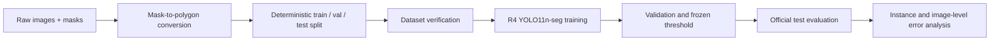
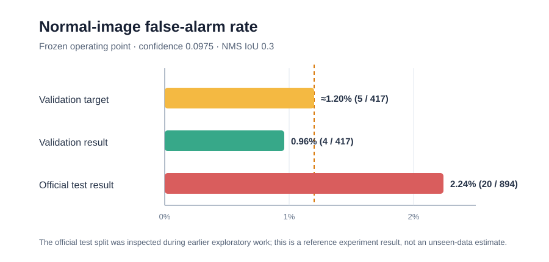

# Industrial Defect Segmentation with YOLO11

A reproducible industrial surface-defect segmentation pipeline built around **KolektorSDD2** and the stock **Ultralytics YOLO11n-seg** implementation. The project covers deterministic data preparation, mask-to-polygon conversion, dataset verification, controlled augmentation experiments, frozen operating-point evaluation, and instance-level error analysis.

The repository is intentionally a focused R4 release. Experimental A1–A4 architectures that depended on a local Ultralytics fork are documented as negative experiments but are not presented as reproducible public code.

## What this project demonstrates

- Conversion of binary defect masks to YOLO segmentation polygons without OpenCV.
- Defect-aware, deterministic train/validation splitting while preserving the official test split.
- Automated checks for corrupt images, invalid polygons, missing pairs, and split leakage.
- A portable R4 training configuration using only stock Ultralytics modules.
- Separation of ranking metrics (mAP) from a frozen, application-oriented operating point.
- Per-image box/mask matching and interpretable FP/FN categories.
- Honest reporting when a low-false-alarm target is not met.



## Main result

Reference environment: Python 3.10.19, PyTorch 2.11.0+cu128, and Ultralytics 8.3.221.

| Metric | Official test |
|---|---:|
| Mask precision | 0.707 |
| Mask recall | 0.547 |
| Mask mAP50 | 0.642 |
| Mask mAP50–95 | 0.285 |
| Localized positive images at frozen operating point | 75 / 110 (68.2%) |
| Normal-image false alarms at frozen operating point | 20 / 894 (2.24%) |

The frozen operating point was `confidence=0.0975`, `NMS IoU=0.3`, with box/mask matching at IoU `0.5`. The observed normal-image false-alarm rate of **2.24% did not meet the original target of approximately 1.20%**, so this is an experimental result—not a deployment-ready AOI system.



> **Evaluation caveat:** after establishing the formal train/validation protocol and freezing R4, the model was evaluated once on the official test split. However, that split had been inspected during earlier exploratory baseline, confidence, and crop work. The result is therefore not treated as a fully unbiased final generalization estimate.

See [RESULTS.md](docs/RESULTS.md), the machine-readable [reference metrics](docs/REFERENCE_METRICS.csv), [EXPERIMENTS.md](docs/EXPERIMENTS.md), and [LIMITATIONS.md](docs/LIMITATIONS.md) for the complete interpretation.

## Quick start

Python 3.10 or 3.11 is recommended. Install PyTorch for the intended CPU/CUDA platform first, then install this project:

```bash
python -m venv .venv
python -m pip install --upgrade pip
python -m pip install -e ".[dev]"
```

The project does not redistribute KolektorSDD2. Obtain it from the [official ViCoS repository](https://github.com/vicoslab/mixed-segdec-net-comind2021), review its license, and extract it locally as:

```text
data/raw/KolektorSDD2/
├── train/
│   ├── 10001.png
│   ├── 10001_GT.png
│   └── ...
└── test/
    ├── 20001.png
    ├── 20001_GT.png
    └── ...
```

Prepare and verify the formal split:

```bash
ksdd2-prepare --source data/raw/KolektorSDD2 --output datasets/kolektorsdd2_yolo_seg_formal
ksdd2-verify --dataset datasets/kolektorsdd2_yolo_seg_formal
pytest -q
```

Expected formal split:

| split | images | defect | normal | segments |
|---|---:|---:|---:|---:|
| train | 1,865 | 197 | 1,668 | 221 |
| val | 466 | 49 | 417 | 51 |
| test | 1,004 | 110 | 894 | 119 |

The expected `split_manifest.csv` SHA-256 for seed 42 is:

```text
1BDEFD653CEA9C5584D92C88629DAEA878FC4A3A61EB985F69D7847DFD436A4D
```

## Train

Inspect the exact plan without importing Ultralytics or starting a run:

```bash
ksdd2-train --config configs/r4_seed42.yaml --dry-run
```

Start the reference run on GPU 0:

```bash
ksdd2-train --config configs/r4_seed42.yaml --device 0
```

For a CPU smoke run, override the expensive settings:

```bash
ksdd2-train --config configs/r4_seed42.yaml --device cpu --epochs 1 --batch 2 --workers 0 --imgsz 128 --name cpu_smoke
```

Select the validation operating point under the fixed budget of at most five normal-image alarms:

```bash
ksdd2-select \
  --model runs/train/r4_seed42/weights/best.pt \
  --dataset datasets/kolektorsdd2_yolo_seg_formal \
  --output reports/metrics/r4_validation_selection \
  --iou 0.3 \
  --max-normal-alarms 5
```

## Evaluate

Standard mAP evaluation uses the Ultralytics validation defaults for confidence ranking and `NMS IoU=0.7`:

```bash
ksdd2-evaluate \
  --model runs/train/r4_seed42/weights/best.pt \
  --data datasets/kolektorsdd2_yolo_seg_formal/data.yaml \
  --split test \
  --iou 0.7 \
  --name official_test_map
```

Recreate the frozen operating-point analysis separately:

```bash
ksdd2-analyze \
  --model runs/train/r4_seed42/weights/best.pt \
  --dataset datasets/kolektorsdd2_yolo_seg_formal \
  --split test \
  --output reports/metrics/r4_test_operating_point \
  --conf 0.0975 \
  --iou 0.3 \
  --match-iou 0.5
```

Generated model files, datasets, previews, and runs are ignored by Git.

## Repository structure

```text
configs/                 frozen R4 hyperparameters and operating point
src/ksdd2_seg/           conversion, splitting, verification, training, and evaluation code
tests/                   synthetic CPU-only tests; no private data or GPU required
docs/                    results, protocol, caveats, and reproducibility notes
metadata/                machine-readable reference result and expected manifest hash
datasets/                generated locally; contents ignored
runs/                    generated locally; contents ignored
reports/                 generated locally; contents ignored
```

## Data and model artifacts

This repository contains pipeline code and aggregate reference metrics. It does not include or grant permission to redistribute:

- KolektorSDD2 images and masks;
- converted datasets, labels, cache files, or dataset-derived previews;
- pretrained or trained model weights/checkpoints, including `.pt` files;
- local Ultralytics settings and machine identifiers;
- the experimental custom Ultralytics fork.

The metrics in this repository are a written reference record from the local experiment. Reproducing them requires obtaining the dataset under its own terms and training a model locally. The code license below applies to this repository's original code; it does not grant rights to the dataset, third-party software, pretrained weights, trained checkpoints, trademarks, or data-derived images. Credit and citation alone do not replace permission required by an asset's license.

See [DATASET.md](docs/DATASET.md), [REPRODUCIBILITY.md](docs/REPRODUCIBILITY.md), and [THIRD_PARTY_NOTICES.md](THIRD_PARTY_NOTICES.md) for source, citation, and artifact boundaries.

The current local release status and remaining pre-publication checks are tracked in the [Traditional Chinese publication checklist](docs/PUBLICATION_CHECKLIST_zh-TW.md).

## License

Original project code is licensed under **AGPL-3.0-only**. This license does not extend to KolektorSDD2, third-party software, model weights, trained checkpoints, or dataset-derived visual assets; those remain subject to their respective terms. No dataset or model-asset license is granted by this repository. See [THIRD_PARTY_NOTICES.md](THIRD_PARTY_NOTICES.md).
