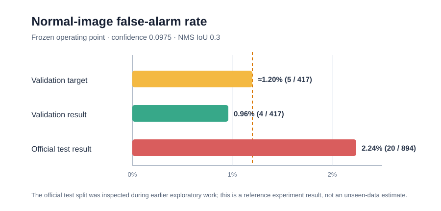

# Reference results

Machine-readable aggregate values are available in [REFERENCE_METRICS.csv](REFERENCE_METRICS.csv), with notes in [REFERENCE_METRICS.md](REFERENCE_METRICS.md). The false-alarm comparison is shown below.

## Dataset

The deterministic seed-42 formal split contains 3,335 images and 391 segmentation instances.

| split | images | defect images | normal images | segments |
|---|---:|---:|---:|---:|
| train | 1,865 | 197 | 1,668 | 221 |
| validation | 466 | 49 | 417 | 51 |
| official test | 1,004 | 110 | 894 | 119 |

Verification passed with zero missing pairs, zero invalid labels, and zero shared image stems across splits.

## Official Ultralytics metrics

The mAP evaluation used `split=test`, confidence `0.001`, prediction NMS IoU `0.7`, and `max_det=300`.

| Metric | Validation | Test | Test − validation |
|---|---:|---:|---:|
| Box mAP50 | 0.595 | 0.600 | +0.005 |
| Box mAP50–95 | 0.258 | 0.275 | +0.017 |
| Mask mAP50 | 0.563 | 0.642 | +0.079 |
| Mask mAP50–95 | 0.252 | 0.285 | +0.033 |

Complete official test metrics:

| Metric | Test |
|---|---:|
| Box precision | 0.631 |
| Box recall | 0.529 |
| Box mAP50 | 0.600 |
| Box mAP50–95 | 0.275 |
| Mask precision | 0.707 |
| Mask recall | 0.547 |
| Mask mAP50 | 0.642 |
| Mask mAP50–95 | 0.285 |

## Frozen operating point

The application-oriented evaluation used `confidence=0.0975`, prediction NMS IoU `0.3`, and a box/mask match threshold of IoU `0.5`.

| Metric | Validation | Test |
|---|---:|---:|
| Box precision | 0.610 | 0.534 |
| Box recall | 0.706 | 0.664 |
| Box F1 | 0.655 | 0.592 |
| Mask precision | 0.525 | 0.534 |
| Mask recall | 0.608 | 0.664 |
| Mask F1 | 0.564 | 0.592 |
| Localized positive images | 35 / 49 | 75 / 110 |
| Image localization recall | 0.714 | 0.682 |
| Box FN | 15 / 51 | 40 / 119 |
| Total box FP | 23 | 69 |
| Normal false-alarm images | 4 / 417 | 20 / 894 |
| Normal-image false-alarm rate | 0.96% | 2.24% |
| Matched mask IoU | 0.653 | 0.676 |
| Matched Dice | 0.782 | 0.796 |

The test false-alarm rate exceeded the original validation-derived target of approximately 1.20% (at most 5 of 417 normal validation images). This failure is part of the result and is not hidden by selecting a new test threshold.

## Error categories on test

Box false negatives:

| Category | Count |
|---|---:|
| No prediction | 18 |
| Weak overlap | 6 |
| Localization | 16 |
| Assignment conflict | 0 |
| Total | 40 |

Box false positives:

| Category | Count |
|---|---:|
| Duplicate | 5 |
| Localization | 18 |
| Off-target | 24 |
| Normal-image predictions | 22 |
| Total | 69 |

Twenty normal images produced 22 predictions, showing that a small number of images contained multiple false alarms.

## Interpretation boundary

These are reference results from the completed local experiment. The official test split had been inspected during earlier exploratory work before the formal protocol was established. The test values are useful evidence for the pipeline, but they are not claimed to be a fully unbiased estimate of unseen deployment performance.
